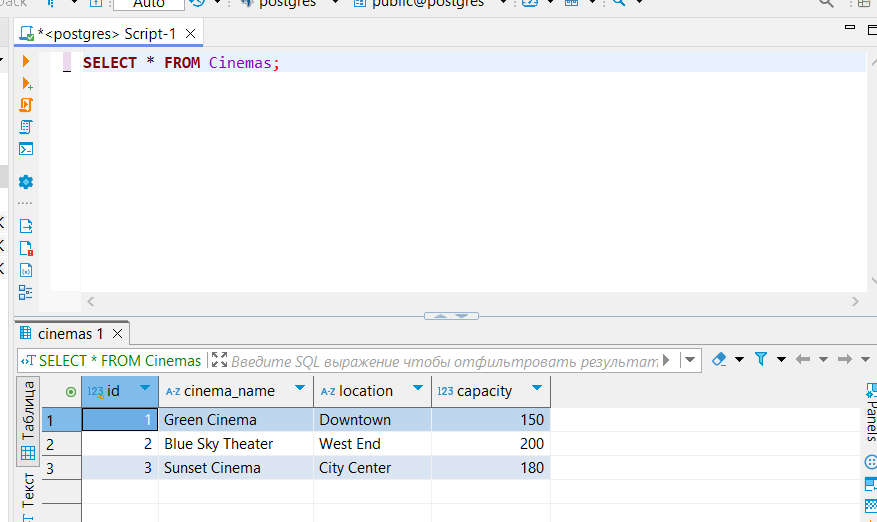
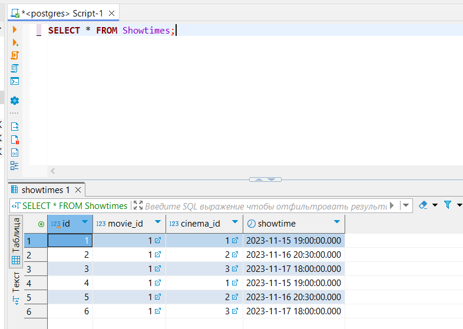

# Практика по теме «Команда Insert»
Это практическое задание поможет вам закрепить знания по теме «Команда Insert». Его выполнение не влияет на прохождение курса и не требует отправки на проверку, но важно для более глубокого понимания материала.

## Как выстроена работа
- Внимательно прочтите условия задания, перейдите в DBeaver и выполните работу.
- Когда закончите работу над заданием, вернитесь в этот материал и нажмите кнопку «Посмотреть решение». Так вы откроете скрипт решения от эксперта.
- Сравните свой вариант решения с предлагаемым, а затем нажмите кнопку «Продолжить», чтобы открыть новую задачу.
- Рекомендуем сначала выполнить задания самостоятельно, а потом посмотреть решение.

## Цели практической работы
- Научиться добавлять данные в таблицы с использованием команды INSERT INTO.
- Освоить добавление данных с выбором столбцов и множественную вставку записей.
- Узнать, как избегать ошибок уникальности при вставке данных.
- Задание 1. Вставка данных в таблицу Cinemas
- Добавьте в таблицу Cinemas три записи о кинотеатрах:

###  Задание 1. Вставка данных в таблицу Cinemas 
Добавьте в таблицу Cinemas три записи о кинотеатрах:

название: Green Cinema, расположение: Downtown, вместимость зала — 150;
название: Blue Sky Theater, расположение: West End, вместимость зала — 200;
название: Sunset Cinema, расположение: City Center, вместимость зала — 180.

 <details>
 <summary> Нажмите, чтоб посмотреть решение</summary>

 ```INSERT INTO Cinemas (cinema_name, location, capacity)```<br>
```VALUES ```<br>
    ```('Green Cinema', 'Downtown', 150),```<br>
    ```('Blue Sky Theater', 'West End', 200),```<br>
    ```('Sunset Cinema', 'City Center', 180);```<br>
</details>

Задание 2. Вставка данных в таблицу Movies
Добавьте в таблицу Movies данные о фильмах:
Inception (2010, продолжительность — 148 минут);
The Matrix (1999, продолжительность — 136 минут);
Titanic (1997, продолжительность — 195 минут).
Проверьте, что при добавлении существующего фильма (например, Inception) возникнет ошибка. Повторите добавление с использованием INSERT IGNORE, чтобы избежать ошибки уникальности. При этом используйте одну из конструкций из материала «Игнорирования ошибок при вставке».

<details>
<summary> Нажмите, чтоб посмотреть решение 2 задания </summary>
1. Скрипт для вставки:

``` INSERT INTO Movies (title, release_year, duration)```<br>
```VALUES ```<br>
    ```('Inception', 2010, 148),```<br>
    ```('The Matrix, 1999, 136),``` <br>
    ```('Titanic', 1997, 195);```<br>
2. Добавление данных с игнорированием конфликта уникальности:

 ```INSERT INTO Movies (title, release_year, duration)```<br>
 ```VALUES ('Inception', 2010, 148)```<br>
 ```ON CON FLICT DO NOTHING;```<br>

 </details>
 Задание 3. Множественная вставка данных в Showtimes<br>
Добавьте три сеанса фильма Inception в таблицу Showtimes:<br>
Green Cinema, время сеанса: 2023-11-15 19:00:00;<br>
Blue Sky Theater, время сеанса: 2023-11-16 20:30:00;<br>
Sunset Cinema, время сеанса: 2023-11-17 18:00:00.<br>
Проверьте, что при попытке добавить сеанс с существующим movie_id и cinema_id, возникает ошибка. Чтобы избежать её, используйте ON DUPLICATE KEY UPDATE и обновитеизмените время сеанса на 19:30:00.
<details>
<summary> Нажмите, чтоб посмотреть решение 3 задания </summary>
1. Скрипт для вставки нескольких записей:

```INSERT INTO Showtimes (movie_id, cinema_id, showtime)```<br>
  ```VALUES ```<br>
    ```(1, 1, '2023-11-15 19:00:00'),```<br>
    ```(1, 2, '2023-11-16 20:30:00'),```<br>
    ```(1, 3, '2023-11-17 18:00:00');```<br>

2. Скрипт для добавления данных с обновлением времени при конфликте:
```INSERT INTO Showtimes (id, movie_id, cinema_id, showtime)```<br>
```VALUES (1, 1, 2, '2023-11-15 19:00:00')```<br>
```ON CONFLICT (id)```<br>
```DO UPDATE SET showtime = '2023-11-15 19:30:00';```<br>
</details>

Решение к заданию 4
Сверьте свой результат с вариантом на скриншотах ниже:
<details>
<summary> Нажмите, чтоб посмотреть решение 4 задания </summary>





</details>


