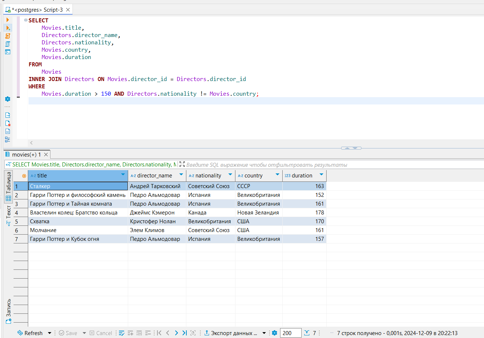
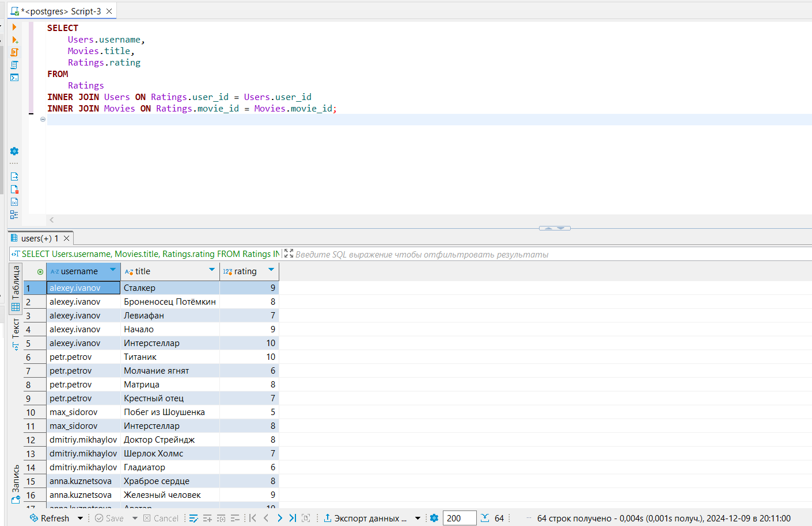
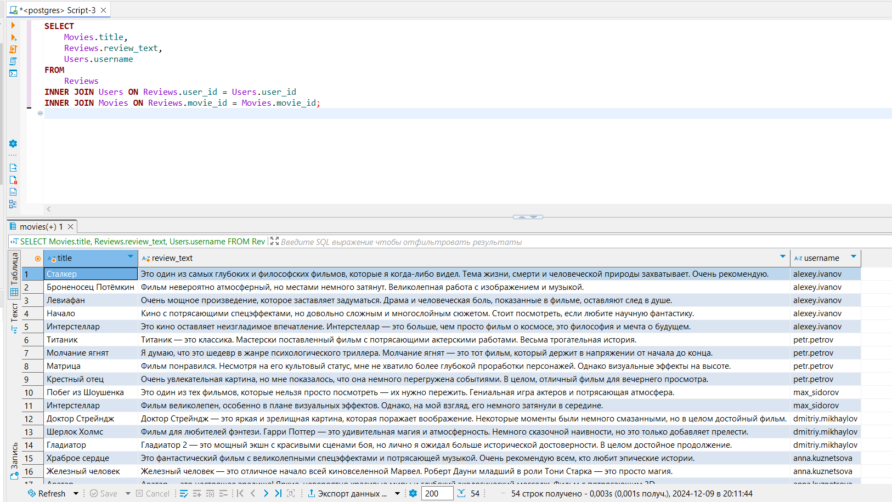
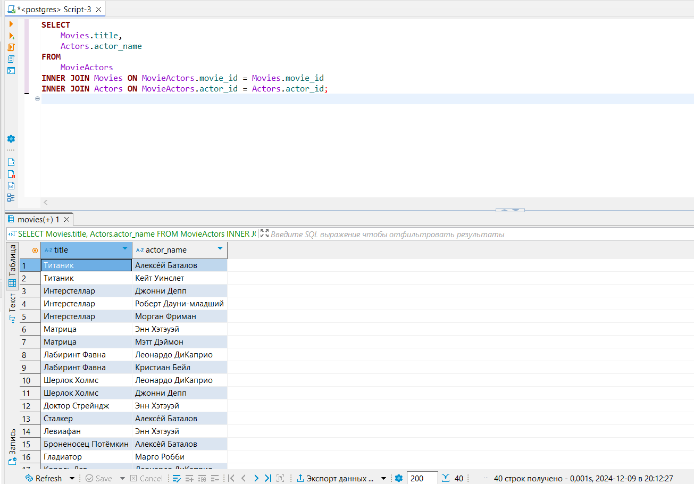
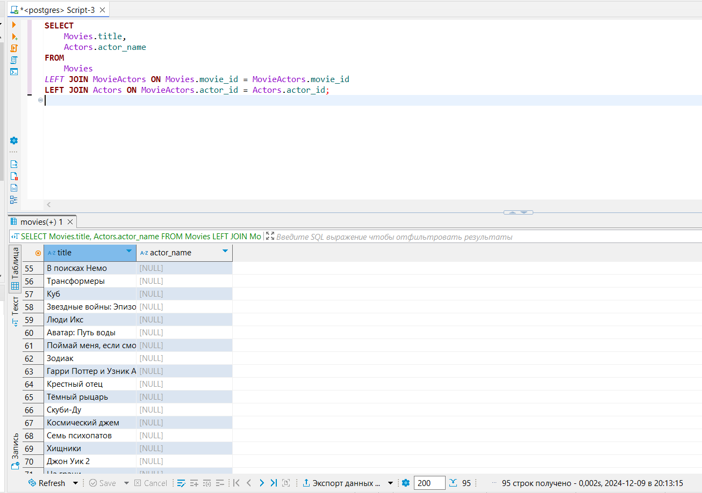
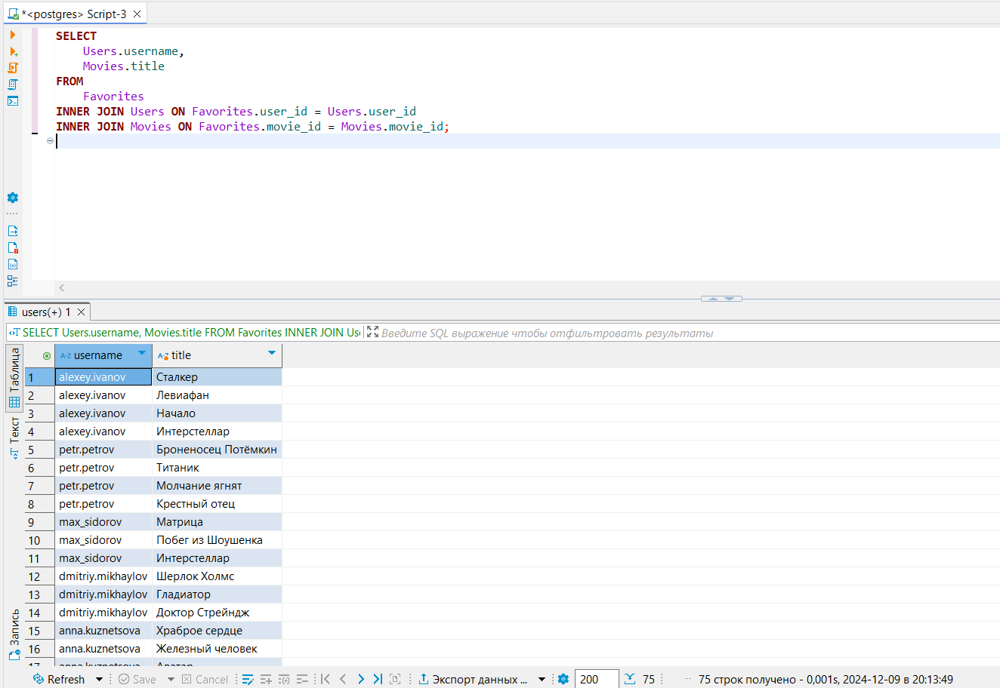
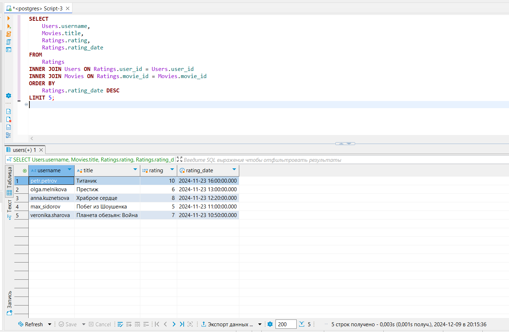
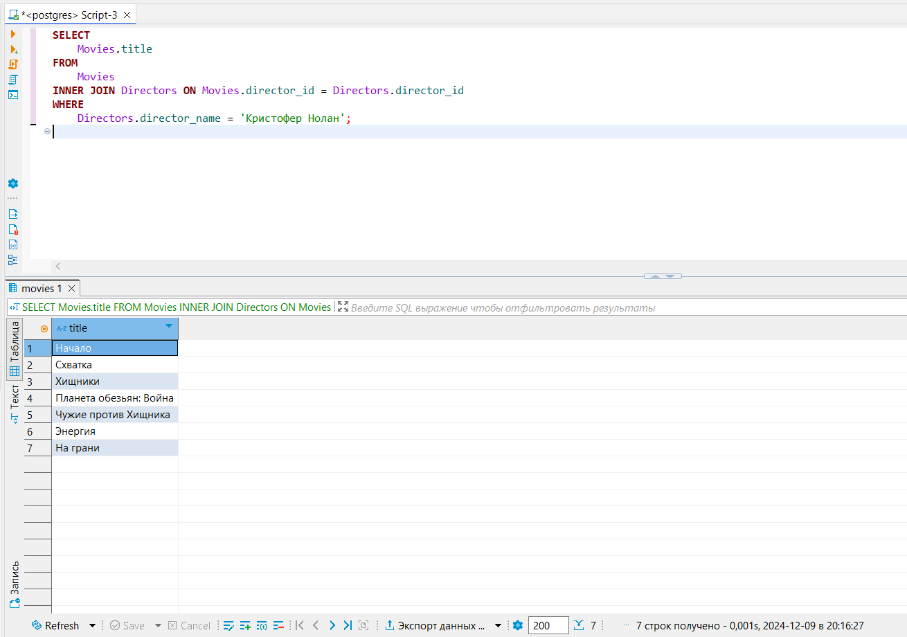
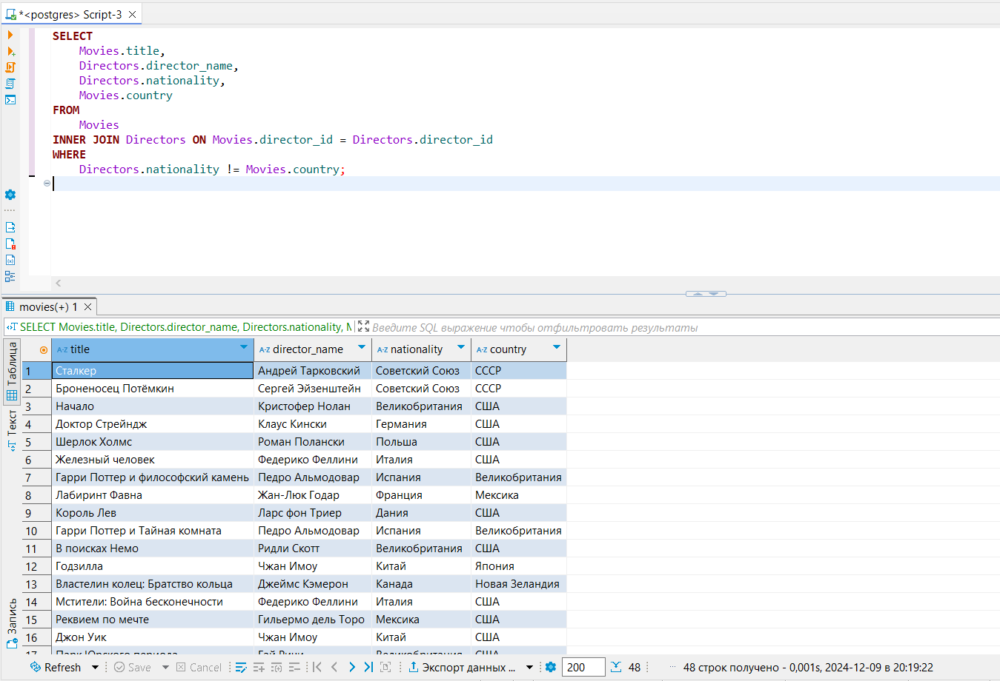
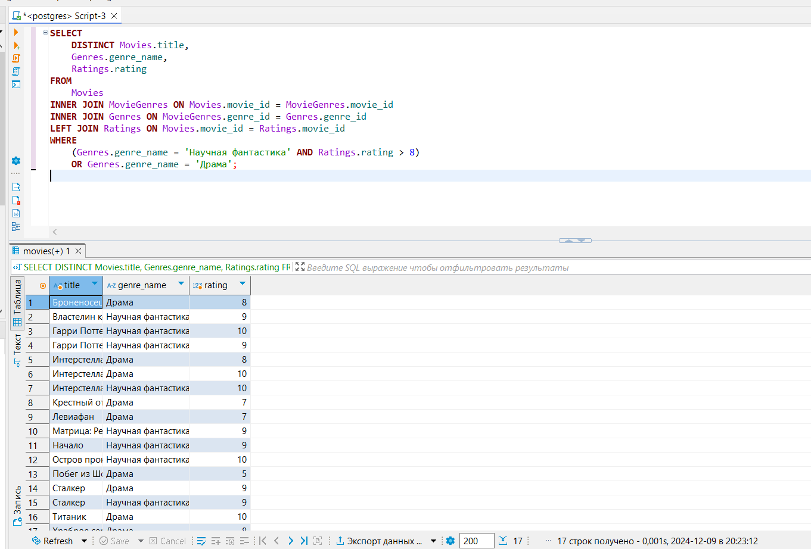

# Практика по теме «Команда JOIN»
Практическое задание поможет вам закрепить знания по теме «Команда JOIN». Это самостоятельная работа, её не нужно отправлять на проверку. Рекомендуем не пропускать практику — она помогает лучшему пониманию материала.

# **Как выполнить задание и проверить себя**

1. Внимательно прочтите условия задания, перейдите в DBeaver и выполните работу.
2. После завершения работы вернитесь в этот материал и нажмите на кнопку «Посмотреть решение». Вы увидите скрипт от эксперта.
3. Сравните свой вариант решения с ответом. Затем нажмите на кнопку «Продолжить» — откроется новая задача.<br><br>
Попробуйте сначала выполнить задание самостоятельно, а уже потом смотреть решение.

# **Цели практической работы**

1. Научиться использовать различные типы объединений (INNER JOIN, LEFT JOIN, RIGHT JOIN).
2. Применить JOIN для работы с несколькими таблицами.
3. Освоить написание запросов для анализа данных с помощью JOIN.<br><br><br>


## Задание 1. Фильмы с длинным хронометражем от иностранных режиссёров <br>
Выведите из базы данных названия фильмов и имена снявших их режиссёров, если продолжительность фильма превышает 150 минут, а страна производства фильма отличается от национальности автора.
<br><strong>Решение к заданию 1</strong><br>
<details>
<summary> Нажмите, чтоб посмотреть решение </summary>


```SELECT ```<br>
    ```Movies.title, ```<br>
    ```Directors.director_name, ```<br>
    ```Directors.nationality, ```<br>
    ```Movies.country```<br>
```FROM``` <br>
    ```Movies```<br>
```INNER JOIN Directors ON Movies.director_id = Directors.director_id```<br>
```WHERE ```<br>
   ``` Movies.duration > 150 AND Directors.nationality != Movies.country;```<br>



   </details>

  ## Задание 2. Список пользователей, оценивших фильмы
Выведите список имён пользователей, названий фильмов, которые они оценили, и сами оценки.
<br><strong>Решение к заданию 2</strong><br>
<details>
<summary> Нажмите, чтоб посмотреть решение </summary>


```SELECT```<br>
```  Users.username,```<br>
```  Movies.title,```<br>
```  Ratings.rating```<br>
```FROM```<br>
```  Ratings```<br>
```INNER JOIN Users ON Ratings.user_id = Users.user_id```<br>
```INNER JOIN Movies ON Ratings.movie_id = Movies.movie_id;```<br>



</details>

## Задание 3. Рецензии пользователей
Создайте запрос, который отобразит названия фильмов, тексты рецензий и имена пользователей, написавших их.
<br><strong>Решение к заданию 3</strong><br>
<details>
<summary> Нажмите, чтоб посмотреть решение </summary>


```SELECT``` <br>
  ```Movies.title,``` <br>
  ```Reviews.review_text,``` <br>
  ```Users.username``` <br>
```FROM``` <br>
  ```Reviews``` <br>
```INNER JOIN Users ON Reviews.user_id = Users.user_id``` <br>
```INNER JOIN Movies ON Reviews.movie_id = Movies.movie_id;``` <br>



</details>

## Задание 4. Актёры в фильмах
Составьте список фильмов и актёров, которые в них играли.

<br><strong>Решение к заданию 4</strong><br>
<details>
<summary> Нажмите, чтоб посмотреть решение </summary>


``` SELECT```<br>
```   Movies.title,```<br>
```   Actors.actor_name```<br>
``` FROM```<br>
```   MovieActors```<br>
``` INNER JOIN Movies ON MovieActors.movie_id = Movies.movie_id```<br>
``` INNER JOIN Actors ON MovieActors.actor_id = Actors.actor_id;```<br>



</details>

## Задание 5. Все фильмы и их актёры
Составьте список всех фильмов с актёрами, которые в них играли. Если у фильма нет актёров, его тоже нужно показать.
<br><strong>Решение к заданию 5</strong><br>
<details>
<summary> Нажмите, чтоб посмотреть решение </summary>


```SELECT```<br>
```  Movies.title,```<br>
```  Actors.actor_name```<br>
```FROM```<br>
```  Movies```<br>
```LEFT JOIN MovieActors ON Movies.movie_id = MovieActors.movie_id```<br>
```LEFT JOIN Actors ON MovieActors.actor_id = Actors.actor_id;```<br>



</details>

## Задание 6. Избранные фильмы пользователей
Выведите список пользователей и фильмов, которые они добавили в избранное.
<br><strong>Решение к заданию 6</strong><br>
<details>
<summary> Нажмите, чтоб посмотреть решение </summary>


```SELECT```<br>
```  Users.username,```<br>
```  Movies.title```<br>
```FROM```<br>
```  Favorites```<br>
```INNER JOIN Users ON Favorites.user_id = Users.user_id```<br>
```INNER JOIN Movies ON Favorites.movie_id = Movies.movie_id;```<br>



</details>

## Задание 7. Последние оценки пользователей
Выведите список последних пяти оценок, которые пользователи поставили фильмам. Покажите имена пользователей, названия фильмов, оценки и дату оценки.
<br><strong>Решение к заданию 7</strong><br>
<details>
<summary> Нажмите, чтоб посмотреть решение </summary>


```SELECT```<br>
```  Users.username,```<br>
```  Movies.title,```<br>
```  Ratings.rating,```<br>
```  Ratings.rating_date```<br>
```FROM```<br>
```  Ratings```<br>
```INNER JOIN Users ON Ratings.user_id = Users.user_id```<br>
```INNER JOIN Movies ON Ratings.movie_id = Movies.movie_id```<br>
```ORDER BY```<br>
```  Ratings.rating_date DESC```<br>
```LIMIT 5;```<br>



 </details>

 ## Задание 8. Фильмы конкретного режиссёра
Выведите названия фильмов, снятых режиссёром Кристофером Ноланом.
<br><strong>Решение к заданию 8</strong><br>
<details>
<summary> Нажмите, чтоб посмотреть решение </summary>


```SELECT```<br>
```  Movies.title```<br>
```FROM```<br>
```  Movies```<br>
```INNER JOIN Directors ON Movies.director_id = Directors.director_id```<br>
```WHERE```<br>
```  Directors.director_name = 'Кристофер Нолан';```<br>



</details>

## Задание 9. Фильмы и иностранные режиссёры
Выведите названия фильмов и имена режиссёров, если их национальность отличается от страны производства ленты.

 <br><strong>Решение к заданию 9</strong><br>

<details>
<summary> Нажмите, чтоб посмотреть решение </summary>


```SELECT```<br>
```  Movies.title,```<br>
```  Directors.director_name,```<br>
```  Directors.nationality,```<br>
```  Movies.country```<br>
```FROM```<br>
```  Movies```<br>
```INNER JOIN Directors ON Movies.director_id = Directors.director_id```<br>
```WHERE```<br>
```  Directors.nationality != Movies.country;```<br>



</details>

## Задание 10. Фильмы определённого жанра и с высокими рейтингами
Выведите названия фильмов:

с оценкой выше 8 баллов, которые относятся к жанру «Научная фантастика»;
которые относятся к жанру «Драма».

<br><strong>Решение к заданию 10</strong><br>

<details>
<summary> Нажмите, чтоб посмотреть решение </summary>


```SELECT```<br>
```   DISTINCT Movies.title,```<br>
```   Genres.genre_name,```<br>
```   Ratings.rating```<br>
```FROM```<br>
```   Movies```<br>
```INNER JOIN MovieGenres ON Movies.movie_id = MovieGenres.movie_id```<br>
```INNER JOIN Genres ON MovieGenres.genre_id = Genres.genre_id```<br>
```LEFT JOIN Ratings ON Movies.movie_id = Ratings.movie_id```<br>
```WHERE```<br>
```   (Genres.genre_name = 'Научная фантастика' AND Ratings.rating > 8)```<br>
```   OR Genres.genre_name = 'Драма';```<br>



</details>


