# Практика по теме «Группировки и агрегирующие функции»
Это практическое задание поможет закрепить знания по теме «Группировки и агрегирующие функции». Это самостоятельная работа, её не нужно отправлять на проверку. Рекомендуем не пропускать практику, благодаря ей вы лучше поймёте материал.


#### <strong>Как выполнить задание и проверить себя </strong>

1. Внимательно прочтите условия задания, перейдите в DBeaver и выполните работу.
2. После завершения работы вернитесь к этому материалу и нажмите на кнопку «Посмотреть решение». Вы увидите скрипт от эксперта.
3. Сравните свой вариант решения с ответом. Затем нажмите на кнопку «Продолжить», откроется новая задача.<br>

Попробуйте сначала выполнить задания самостоятельно, а уже потом смотреть решение.


#### <strong> Цели практической работы</strong>

- Познакомиться с принципами использования группировок и агрегирующих функций в SQL.
- Научиться создавать запросы с использованием команд (GROUP BY, HAVING) и агрегирующих функций (SUM, AVG, COUNT, MIN, MAX).
- Исследовать возможности фильтрации и группировки данных в таблицах.
- Выполнить задания по анализу данных, используя тестовые данные, и применить агрегирующие функции.


## Задание 1. Количество фильмов в базе
Посчитайте общее количество фильмов в базе данных.

<br><strong>Решение к заданию 1</strong><br>
<details>
<summary> Нажмите, чтоб посмотреть решение </summary>

```SELECT COUNT(*) AS total_movies```<br>
```FROM Movies;```<br>
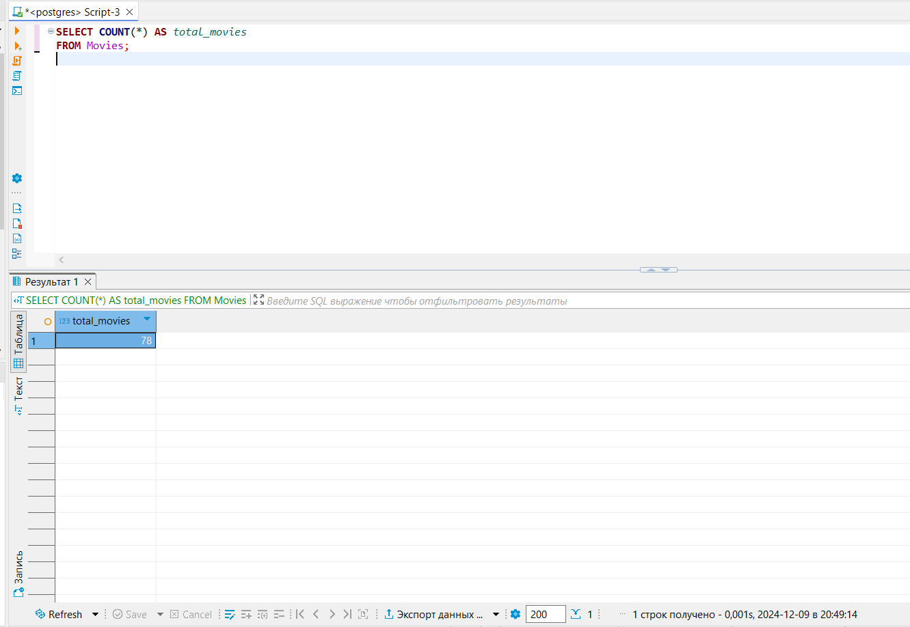

</details>

## Задание 2. Средняя продолжительность фильмов
Найдите среднюю продолжительность фильмов в базе данных.

<br><strong>Решение к заданию 2</strong><br>
<details>
<summary> Нажмите, чтоб посмотреть решение </summary>

```SELECT AVG(duration) AS average_duration```<br>
```FROM Movies;```<br>

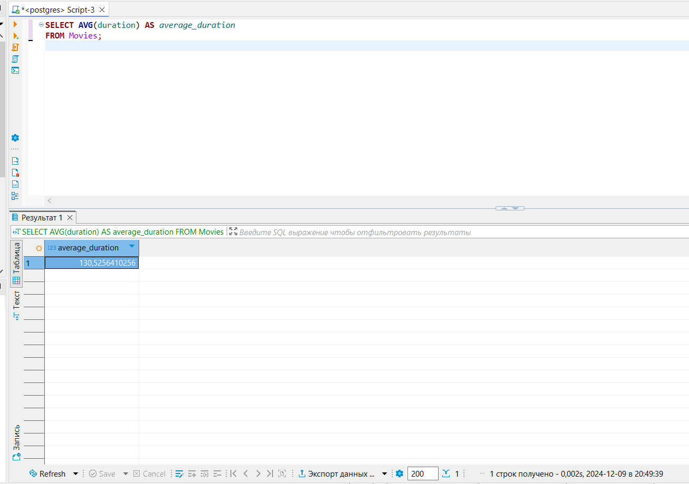

</details>

## Задание 3. Самый старый фильм
Найдите год выпуска самого старого фильма.

<br><strong>Решение к заданию 3</strong><br>
<details>
<summary> Нажмите, чтоб посмотреть решение </summary>

```SELECT MIN(release_year) AS oldest_movie_year```<br>
```FROM Movies;```<br>

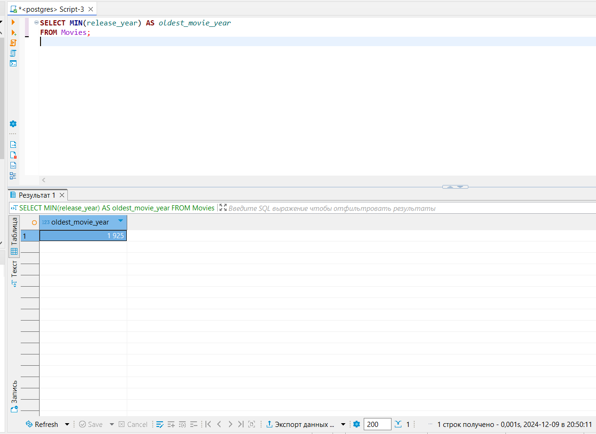

</details>

## Задание 4. Новый фильм с максимальной длительностью
Определите название самого длинного фильма, вышедшего после 2000 года.

<br><strong>Решение к заданию 4</strong><br>
<details>
<summary> Нажмите, чтоб посмотреть решение </summary>

```SELECT title ```<br>
```FROM Movies ```<br>
```WHERE duration = (SELECT MAX(duration) FROM Movies WHERE release_year > 2000) ```<br>
```AND release_year > 2000;```<br>

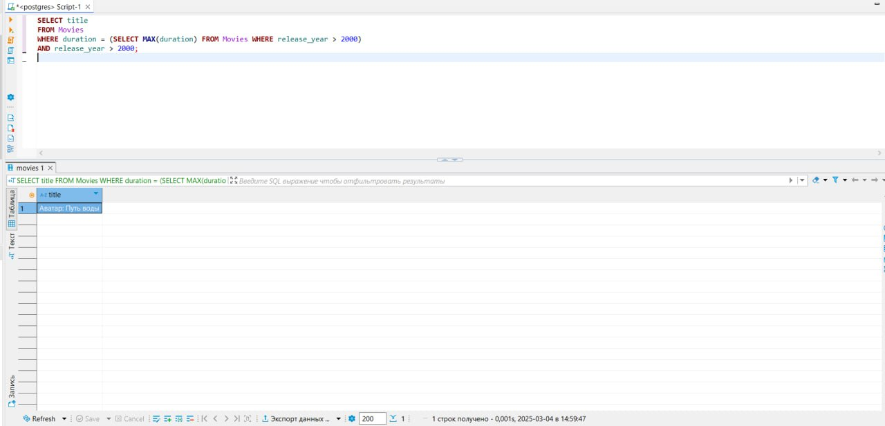

</details>

## Задание 5. Количество фильмов по странам
Посчитайте, сколько фильмов было выпущено в каждой стране.

<br><strong>Решение к заданию 5</strong><br>
<details>
<summary> Нажмите, чтоб посмотреть решение </summary>

```SELECT country, COUNT(*) AS movie_count```<br>
```FROM Movies```<br>
```GROUP BY country;```<br>

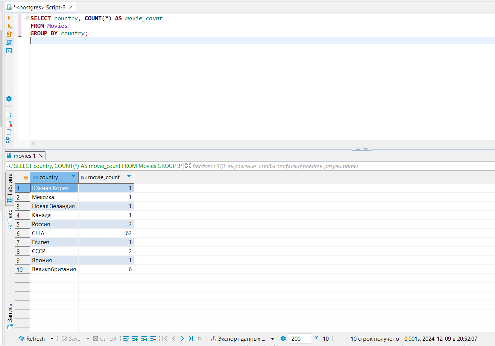

</details>

## Задание 6. Средняя оценка каждого фильма
Вычислите среднюю оценку каждого фильма из базы данных.

<br><strong>Решение к заданию 6</strong><br>
<details>
<summary> Нажмите, чтоб посмотреть решение </summary>

```SELECT movie_id, AVG(rating) AS average_rating```<br>
```FROM Ratings```<br>
```GROUP BY movie_id;```<br>

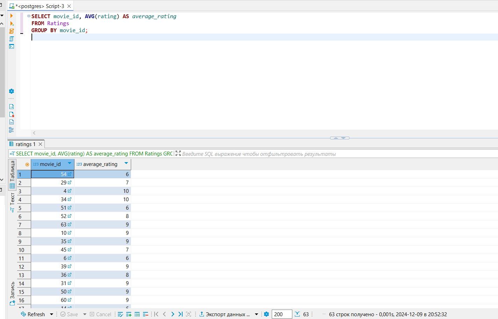

</details>

## Задание 7. Режиссёры с несколькими фильмами
Определите режиссёров, которые сняли более одного фильма.

<br><strong>Решение к заданию 7</strong><br>
<details>
<summary> Нажмите, чтоб посмотреть решение </summary>

```SELECT director_id, COUNT(*) AS movie_count```<br>
```FROM Movies```<br>
```GROUP BY director_id```<br>
```HAVING COUNT(*) > 1;```<br>

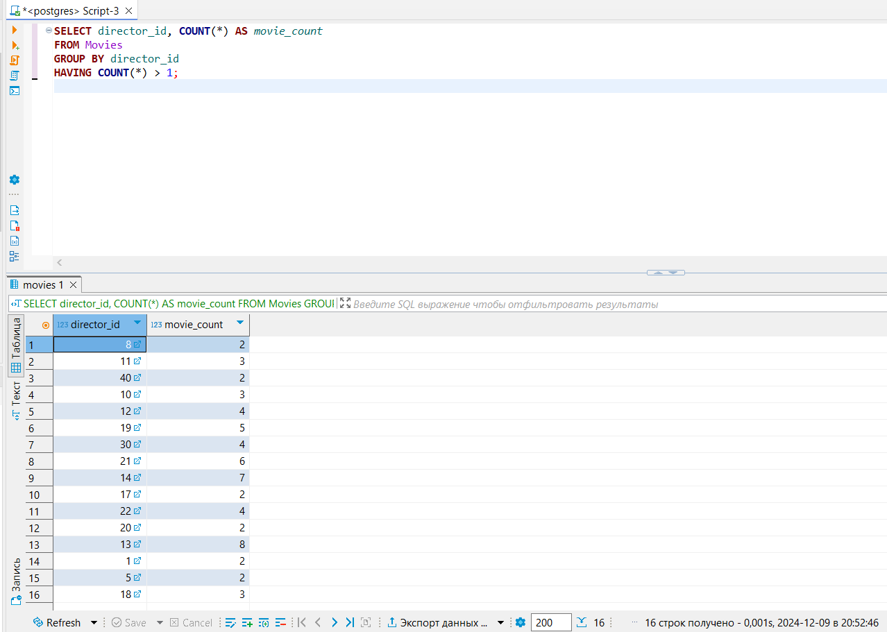

</details>

## Задание 8. Жанры с самым большим количеством фильмов
Определите жанры, к которым относится больше всего фильмов. Отсортируйте список по убыванию.

<br><strong>Решение к заданию 8</strong><br>
<details>
<summary> Нажмите, чтоб посмотреть решение </summary>

```SELECT genre_name, COUNT(*) AS genre_count```<br>
```FROM MovieGenres```<br>
```INNER JOIN Genres ON MovieGenres.genre_id = Genres.genre_id```<br>
```GROUP BY genre_name```<br>
```ORDER BY genre_count DESC;```<br>

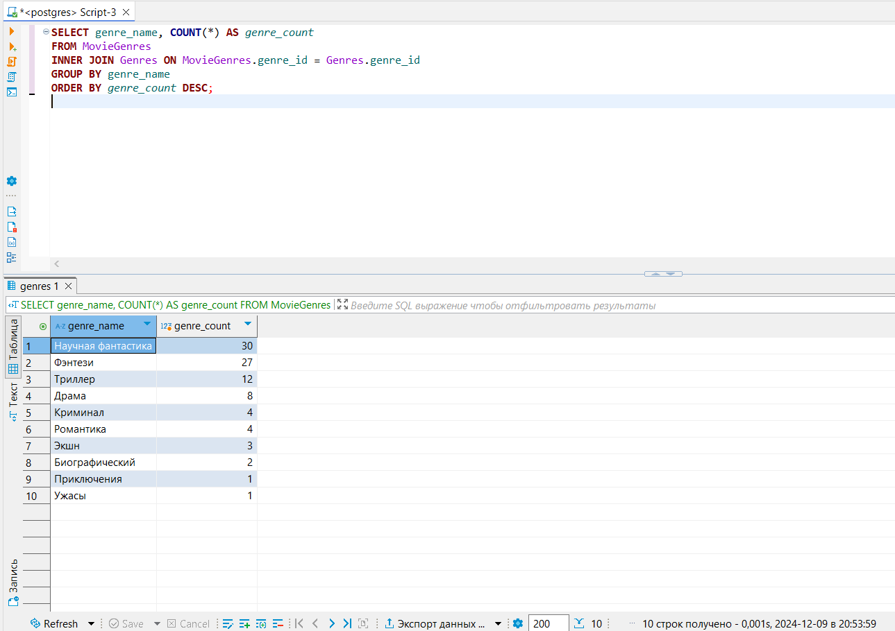

</details>

## Задание 9. Самые популярные актёры
Выведите имена актёров, которые снялись в максимальном количестве фильмов. Отсортируйте список по убыванию.

<br><strong>Решение к заданию 9</strong><br>
<details>
<summary> Нажмите, чтоб посмотреть решение </summary>

```SELECT Actors.actor_name, COUNT(*) AS movie_count```<br>
```FROM MovieActors```<br>
```INNER JOIN Actors ON MovieActors.actor_id = Actors.actor_id```<br>
```GROUP BY Actors.actor_name```<br>
```ORDER BY movie_count DESC;```<br>

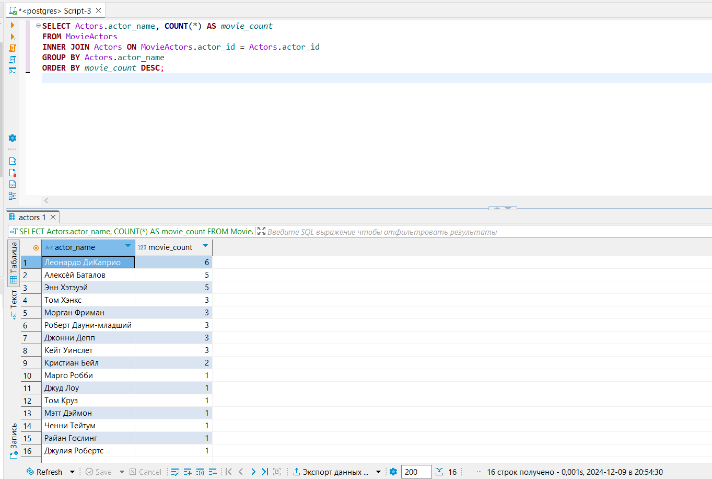

</details>

## Задание 10. Количество рецензий для каждого фильма
Найдите количество рецензий у каждого фильма.

<br><strong>Решение к заданию 10</strong><br>
<details>
<summary> Нажмите, чтоб посмотреть решение </summary>

```SELECT Movies.title, COUNT(Reviews.review_id) AS review_count```<br>
```FROM Movies```<br>
```LEFT JOIN Reviews ON Movies.movie_id = Reviews.movie_id```<br>
```GROUP BY Movies.title```<br>
```ORDER BY review_count DESC;```<br>

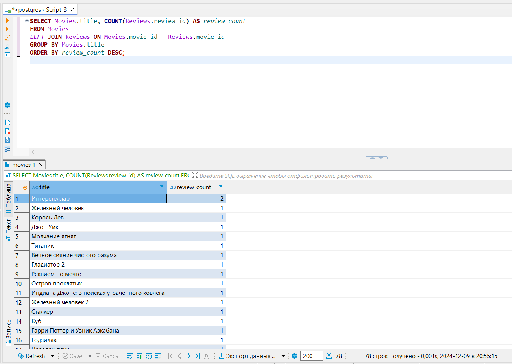

</details>

## Задание 11. Пользователи, оставившие больше 5 оценок
Выведите пользователей, которые поставили фильмам больше пяти оценок. Отсортируйте список по их количеству в порядке убывания.

<br><strong>Решение к заданию 11</strong><br>
<details>
<summary> Нажмите, чтоб посмотреть решение </summary>

```SELECT Users.username, COUNT(Ratings.rating_id) AS rating_count```<br>
```FROM Users```<br>
```INNER JOIN Ratings ON Users.user_id = Ratings.user_id```<br>
```GROUP BY Users.username```<br>
```HAVING COUNT(Ratings.rating_id) > 5```<br>
```ORDER BY rating_count DESC;```<br>

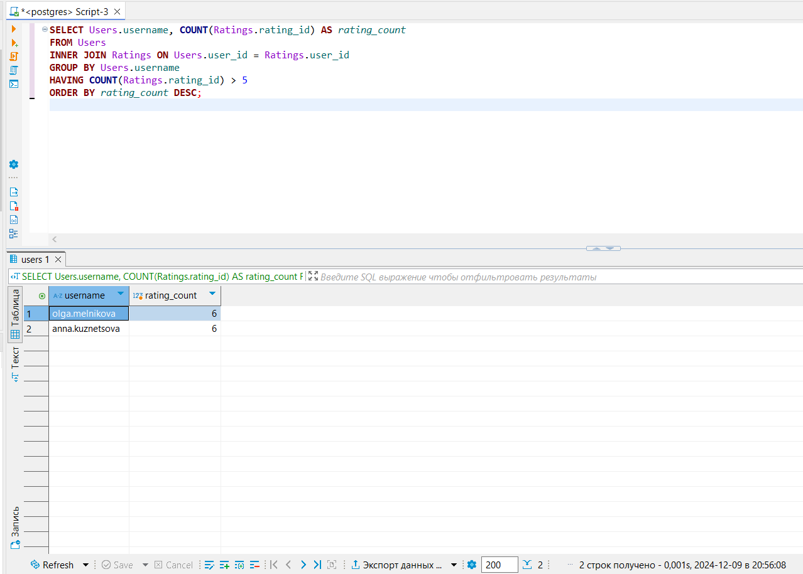

</details>

## Задание 12. Фильмы, добавленные в избранное
Выведите названия фильмов, которые были добавлены в избранное больше одного раза.

<br><strong>Решение к заданию 12</strong><br>
<details>
<summary> Нажмите, чтоб посмотреть решение </summary>

```SELECT Movies.title, COUNT(Favorites.favorite_id) AS favorite_count```<br>
```FROM Movies```<br>
```INNER JOIN Favorites ON Movies.movie_id = Favorites.movie_id```<br>
```GROUP BY Movies.title```<br>
```HAVING COUNT(Favorites.favorite_id) 1;```<br>

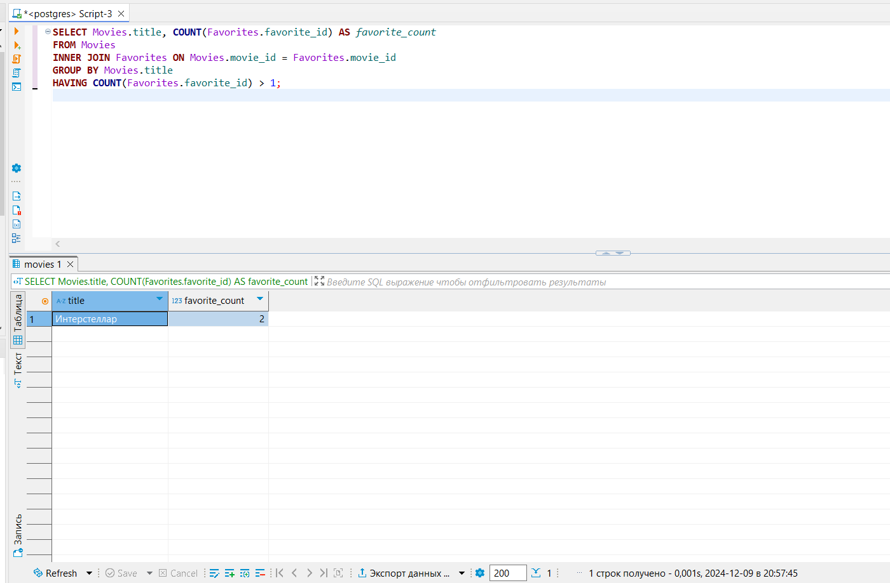
</details>


