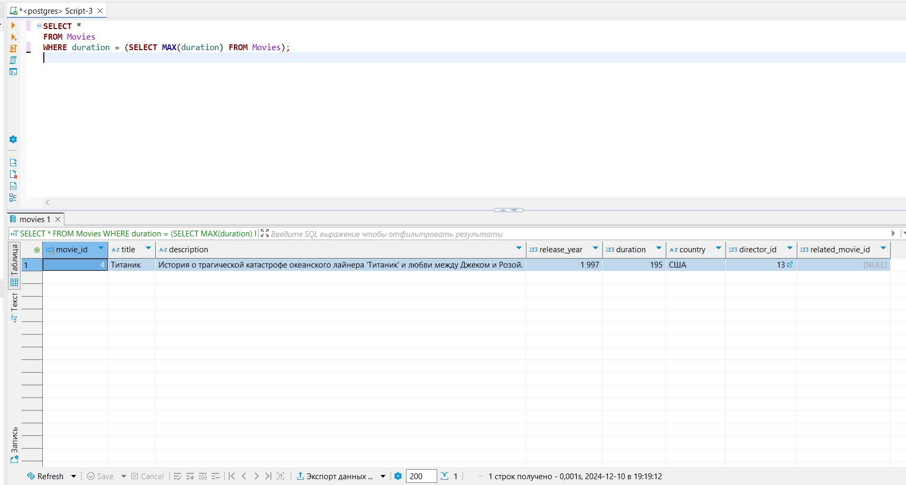
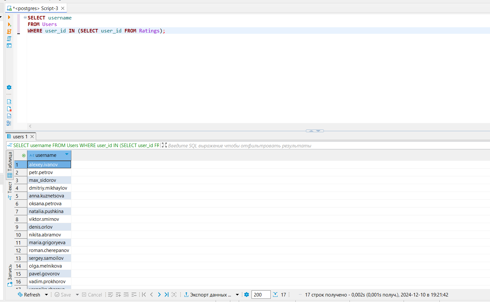
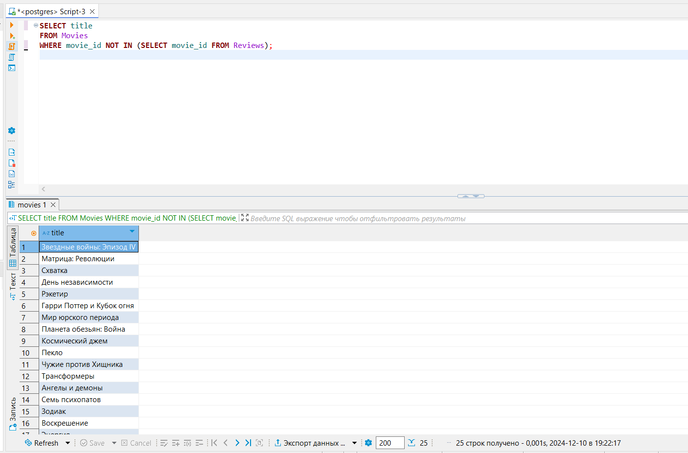
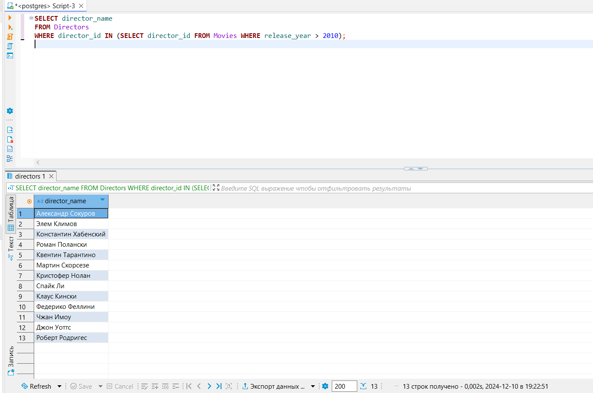
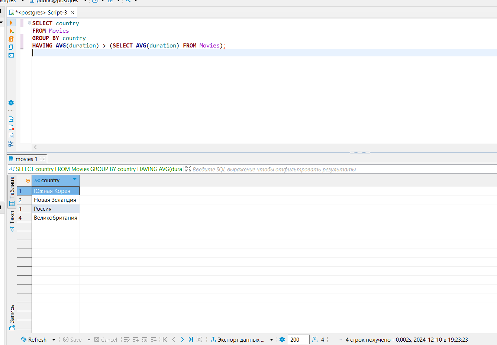
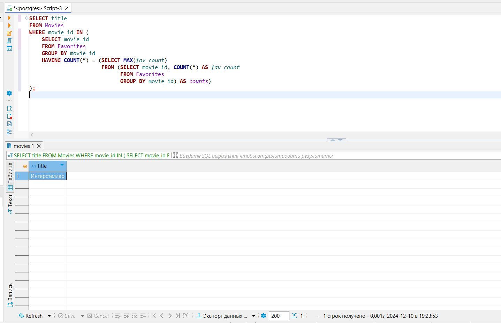
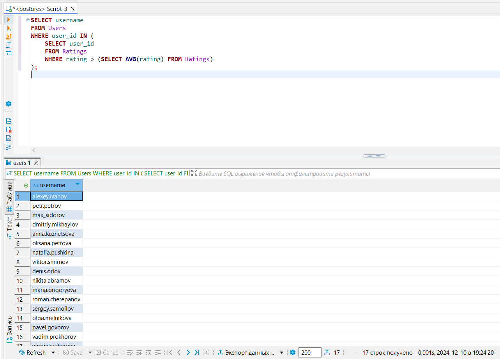
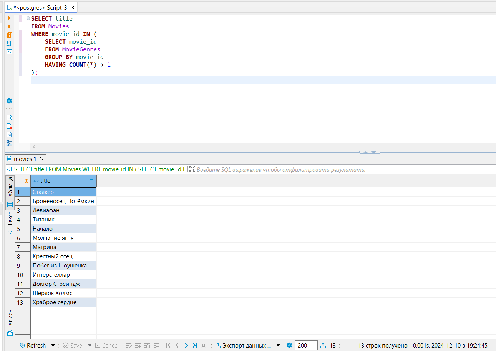
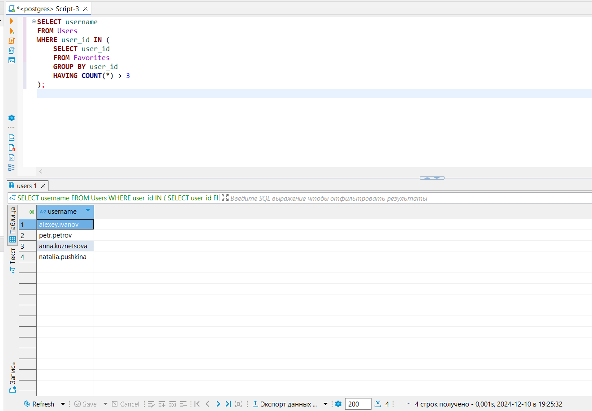
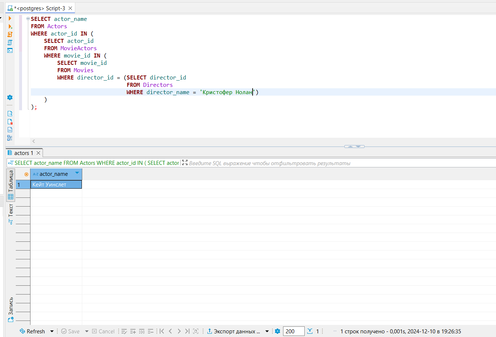

# Практика по теме «Подзапросы»
Практическое задание поможет вам закрепить знания по теме «Подзапросы». Это самостоятельная работа, её не нужно отправлять на проверку. Рекомендуем не пропускать эту практику, она важна для лучшего понимания материала.


# **Как выполнить задание и проверить себя**

1. Внимательно прочтите условия задания, перейдите в DBeaver и выполните работу.
2. После завершения работы над заданием вернитесь в этот материал и нажмите на кнопку «Посмотреть решение». Вы увидите скрипт от эксперта.
3. Сравните свой вариант решения с ответом. Затем нажмите на кнопку «Продолжить» — откроется новая задача.<br><br>
Попробуйте сначала выполнить задания самостоятельно, а уже потом смотреть решение.<br>


## Цели практической работы

- Ознакомиться с принципами использования подзапросов в SQL.
- Научиться создавать запросы с использованием вложенных подзапросов в операторах SELECT, FROM, WHERE и HAVING.
- Исследовать различия между коррелирующими и некоррелирующими подзапросами.
- Проанализировать данные с помощью подзапросов для фильтрации и вычислений и получить агрегированные результаты.

## Задание 1. Фильмы с наибольшей продолжительностью
Выведите из базы данных все данные о фильмах, у которых максимальная продолжительность среди всех кинолент.

<br><strong>Решение к заданию 1</strong><br>
<details>
<summary> Нажмите, чтоб посмотреть решение </summary>

```SELECT *```<br>
```FROM Movies```<br>
```WHERE duration = (SELECT MAX(duration) FROM Movies);```<br>


</details>

## Задание 2. Пользователи, оставившие хотя бы одну оценку
Выведите имена пользователей, которые поставили хотя бы одну оценку фильмам.

<br><strong>Решение к заданию 2</strong><br>
<details>
<summary> Нажмите, чтоб посмотреть решение </summary>

```SELECT username```<br>
```FROM Users```<br>
```WHERE user_id IN (SELECT user_id FROM Ratings);```<br>


</details>

## Задание 3. Фильмы без рецензий
Найдите фильмы, у которых нет ни одной рецензии.

<br><strong>Решение к заданию 3</strong><br>
<details>
<summary> Нажмите, чтоб посмотреть решение </summary>

```SELECT title```<br>
```FROM Movies```<br>
```WHERE movie_id NOT IN (SELECT movie_id FROM Reviews);```<br>


</details>

## Задание 4. Режиссёры, снявшие фильмы после 2010 года
Выведите имена режиссёров, которые сняли хотя бы один фильм после 2010 года.

<br><strong>Решение к заданию 4</strong><br>
<details>
<summary> Нажмите, чтоб посмотреть решение </summary>

```SELECT director_name```<br>
```FROM Directors```<br>
```WHERE director_id IN (SELECT director_id FROM Movies WHERE release_year > 2010);```<br>


</details>

## Задание 5. Средняя продолжительность фильмов по странам
Выведите названия стран, в которых средняя продолжительность фильмов выше средней продолжительности всех фильмов в базе данных.

<br><strong>Решение к заданию 5</strong><br>
<details>
<summary> Нажмите, чтоб посмотреть решение </summary>

```SELECT country```<br>
```FROM Movies```<br>
```GROUP BY country```<br>
```HAVING AVG(duration) > (SELECT AVG(duration) FROM Movies);```<br>


</details>

## Задание 6. Самые популярные фильмы
Найдите фильмы, которые были добавлены в избранное больше раз, чем другие.

<br><strong>Решение к заданию 6</strong><br>
<details>
<summary> Нажмите, чтоб посмотреть решение </summary>

```SELECT title```<br>
```FROM Movies```<br>
```WHERE movie_id IN (```<br>
```  SELECT movie_id```<br>
```  FROM Favorites```<br>
```  GROUP BY movie_id```<br>
```  HAVING COUNT(*) = (SELECT MAX(fav_count)```<br>
```            FROM (SELECT movie_id, COUNT(*) AS fav_count```<br>
```               FROM Favorites```<br>
```               GROUP BY movie_id) AS counts)```<br>


</details>

## Задание 7. Пользователи, которые оценили фильмы выше среднего
Найдите пользователей, которые поставили хотя бы одну оценку выше средней оценки всех фильмов.

<br><strong>Решение к заданию 7</strong><br>
<details>
<summary> Нажмите, чтоб посмотреть решение </summary>

```SELECT username```<br>
```FROM Users```<br>
```WHERE user_id IN (```<br>
```  SELECT user_id```<br>
```  FROM Ratings```<br>
```  WHERE rating (SELECT AVG(rating) FROM Ratings)```<br>
```);```<br>



</details>

## Задание 8. Фильмы, снятые в нескольких жанрах
Выведите названия фильмов, которые относятся к нескольким жанрам.

<br><strong>Решение к заданию 8</strong><br>
<details>
<summary> Нажмите, чтоб посмотреть решение </summary>

```SELECT title```<br>
```FROM Movies```<br>
```WHERE movie_id IN (```<br>
```  SELECT movie_id```<br>
```  FROM MovieGenres```<br>
```  GROUP BY movie_id```<br>
```  HAVING COUNT(*) 1```<br>
```);```<br>


</details>

## Задание 9. Пользователи, добавившие в избранное несколько фильмов
Выведите имена пользователей, которые добавили в избранное более чем три фильма.

<br><strong>Решение к заданию 9</strong><br>
<details>
<summary> Нажмите, чтоб посмотреть решение </summary>

```SELECT username```<br>
```FROM Users```<br>
```WHERE user_id IN (```<br>
```  SELECT user_id```<br>
```  FROM Favorites```<br>
```  GROUP BY user_id```<br>
```  HAVING COUNT(*) ```<br>
```);```<br>


</details>

## Задание 10. Актёры, снимавшиеся у Кристофера Нолана
Найдите имена актёров, которые снимались в фильмах режиссёра Кристофера Нолана.

<br><strong>Решение к заданию 10</strong><br>
<details>
<summary> Нажмите, чтоб посмотреть решение </summary>

```ELECT actor_name```<br>
```FROM Actors```<br>
```WHERE actor_id IN (```<br>
```  SELECT actor_id```<br>
```  FROM MovieActors```<br>
```  WHERE movie_id IN (```<br>
```    SELECT movie_id```<br>
```    FROM Movies```<br>
```    WHERE director_id = (SELECT director_id```<br>
```               FROM Directors```<br>
```               WHERE director_name = 'Кристофер Нолан')```<br>
``` )```<br>
```);```<br>


</details>


